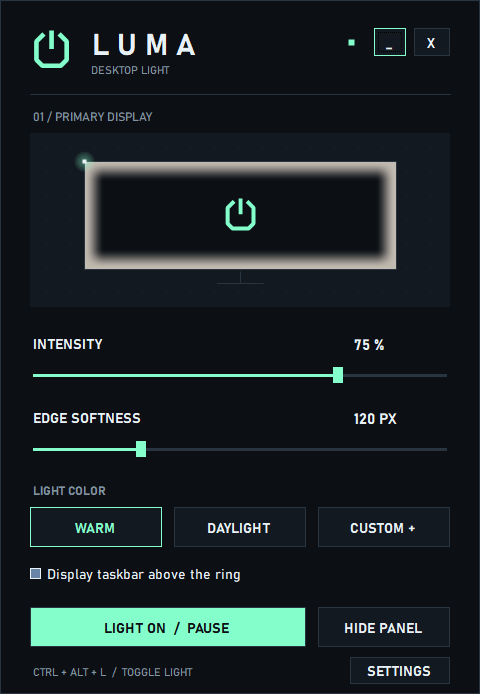

# LUMA

A soft, feathered ring light around your primary Windows display.

**[Download LUMA for Windows](https://github.com/caseyrose131/Luma-Desktop-Ring-Light/releases/latest/download/LUMA-Windows.zip)**

Extract all files, then double-click `LUMA.exe`. No installation needed.

- Adjustable brightness, edge softness, and color.
- Click-through light with a live preview.
- Show the taskbar above the ring (enabled by default).
- Choose apps to keep clear of the glow.
- Ctrl+Alt+L to toggle; system tray controls.
- Single-instance protection.

## Requirements

Windows 10/11 with .NET Framework 4.x.

## Use

Hide Panel keeps the light running. Reopen it from the tray icon.
Click X or choose Quit LUMA from the tray to exit.
Settings are stored beside the app in `settings.txt` and `layers.txt`.

## Build

Run `build.ps1` in PowerShell on Windows. It uses the .NET Framework C# compiler
and generates the icon and executable. No third-party packages are required.

## Update

Quit LUMA, extract the new release into your app folder, and retain your
`settings.txt` and `layers.txt` files.
